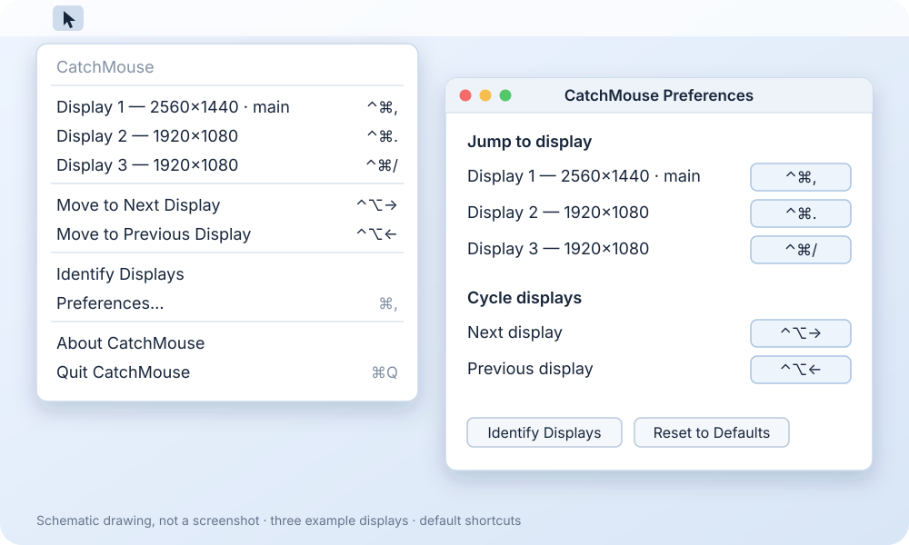

# CatchMouse

Jump the mouse cursor between displays with a global keyboard shortcut.



Version 2.1.0, 30 May 2026 · macOS 11 or later · MIT license · no binary
release: [build it from source](#install) with the Xcode Command Line Tools.

A modern, **Apple-Silicon-native** reimplementation of the classic
[CatchMouse](https://github.com/round/CatchMouse) utility (v1.2, ftnew.com,
2011), which shipped only as a 32/64-bit **Intel** binary and runs on Apple
Silicon Macs solely through Rosetta. This is a clean rewrite in Swift — it
builds and runs natively on `arm64`, with no original code or assets reused.

## Why

The original `CatchMouse.app` is an Intel-only (`i386` + `x86_64`) binary with no
published source, so it cannot be rebuilt for Apple Silicon. This project
reproduces its behaviour — move the cursor to a chosen display instantly — as a
small, dependency-free menu-bar agent built with the modern toolchain.

## Features

- **Per-display hotkeys** — `⌃⌘,` / `⌃⌘.` / `⌃⌘/` warp the cursor to the
  centre of the **first / second / third display from the left**.
- **Cycle** — `⌃⌥→` / `⌃⌥←` move to the next / previous display, wrapping
  around.
- **Customisable** — set your own shortcut for each display (and for cycling)
  in the **Preferences** window; bindings are saved per monitor and survive
  reconnects.
- **Identify Displays** — flash a big number on each screen so you know which
  is which.
- **Menu-bar agent** — lives in the menu bar (no Dock icon); the menu lists
  every attached display and its size, and updates live as you plug monitors
  in and out.
- **No Accessibility permission required** — cursor movement uses
  `CGWarpMouseCursorPosition` rather than synthetic events.
- **Scriptable** — the same actions are available as CLI verbs, so you can
  bind them to your own launcher or window manager.
- **Native** — runs natively on Apple Silicon (`arm64`); `build_app.sh` also
  adds an `x86_64` slice for Intel Macs when the toolchain allows, producing a
  universal binary. No Rosetta needed.

## Install

### Build from source

Requires the Xcode Command Line Tools (`xcode-select --install`). A full Xcode
install is **not** needed.

```sh
git clone https://github.com/zhouyi-xiaoxiao/CatchMouse.git
cd CatchMouse
./build_app.sh
```

This produces `build/CatchMouse.app`. Move it to `/Applications` and launch it:

```sh
cp -R build/CatchMouse.app /Applications/
open /Applications/CatchMouse.app
```

A cursor icon appears in the menu bar. The app launches as a background agent,
so there is no Dock icon or window.

## Usage

### Global hotkeys

| Shortcut | Action |
| --- | --- |
| `⌃⌘,` / `⌃⌘.` / `⌃⌘/` | Jump to the first / second / third display from the left |
| `⌃⌥→` | Move to the next display |
| `⌃⌥←` | Move to the previous display |

Displays are numbered left → right by their position in the global desktop.
`⌃⌘,` `⌃⌘.` `⌃⌘/` jump to the first, second and third display from the left —
with three displays that is left / centre / right; with two, `⌃⌘.` is the
right-hand display. With more than three, use `⌃⌥→` / `⌃⌥←` (or assign your
own shortcuts in Preferences) to reach the rest.

**Customise shortcuts:** open **Preferences…** from the menu-bar icon, click any
recorder and press the combination you want (⎋ cancels, ⌫ clears). Each
display's binding is stored per monitor by its UUID, so it sticks even after you
unplug and replug. **Identify Displays** flashes a number on every screen so you
can tell them apart.

### Command line

Running the binary with an argument performs a single action and exits — handy
for scripting or binding to another tool:

```sh
CatchMouse --list        # list displays: number, id, size, position
CatchMouse --move 2      # warp the cursor to the centre of display 2
CatchMouse --move-next   # warp to the next display
CatchMouse --move-prev   # warp to the previous display
CatchMouse --preferences # launch the menu-bar agent and open Preferences
CatchMouse --version     # print the version
CatchMouse --help        # print all verbs and their short forms
```

(The binary inside the bundle is at
`build/CatchMouse.app/Contents/MacOS/CatchMouse`.)

## Development

```sh
swift build            # debug build
swift run CatchMouse --list
./build_app.sh         # release .app bundle (universal when possible)
```

- `DisplayManager.swift` — enumerate displays, compute centres, warp the cursor
- `HotKeyCenter.swift` — Carbon `RegisterEventHotKey` wrapper for global hotkeys
- `Shortcuts.swift` / `KeyCombo.swift` — default shortcuts and key-combo model
- `HotKeyStore.swift` — per-display bindings saved by display UUID
- `PreferencesWindowController.swift` / `HotKeyRecorderView.swift` — Preferences window and click-to-record control
- `AppDelegate.swift` / `StatusMenuController.swift` — menu-bar item, wiring, display-change handling
- `CLI.swift` / `main.swift` — scriptable `--list` / `--move*` verbs and entry point

## Credits

Inspired by the original **CatchMouse** by ftnew.com. This is an independent
reimplementation of its behaviour, written from scratch — no source, binary,
or artwork from the original is included.

## License

[MIT](LICENSE).

---

Xiaoxiao Zhouyi · [zhouyixiaoxiao.com](https://zhouyixiaoxiao.com/)
